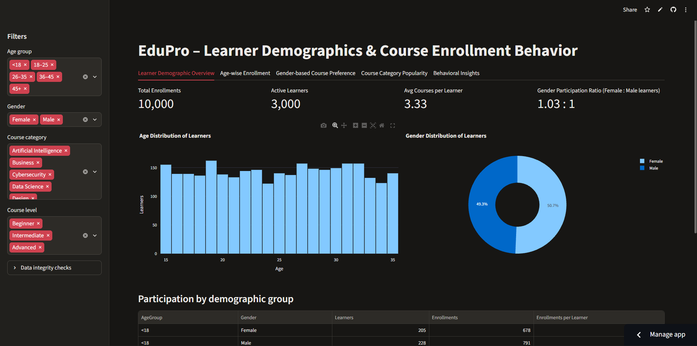
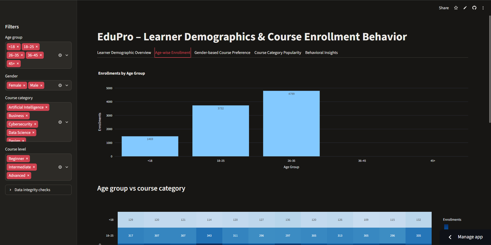
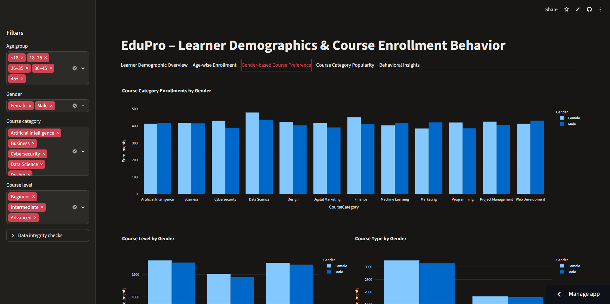
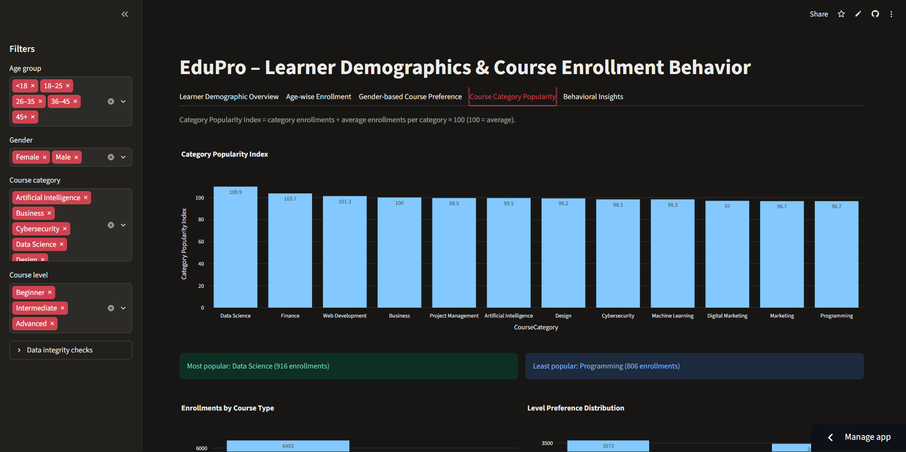
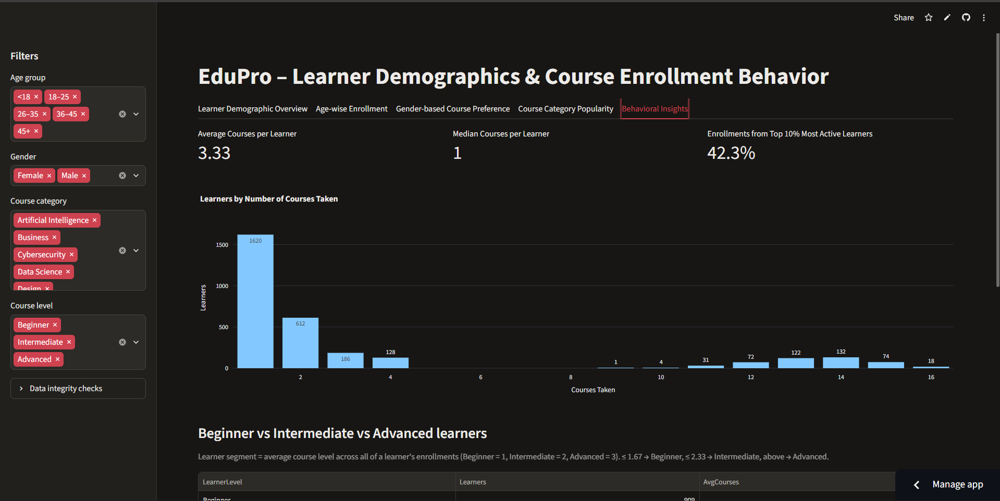

# 🎓 EduPro Learner Demographics & Course Enrollment Behavior Analysis

A data analytics dashboard built using Python and Streamlit that shows **who EduPro's learners are and how they choose courses**, using the platform's Users, Courses and Transactions data.

This project combines:

- 🔗 Data integration with referential-integrity checks
- 👥 Learner demographic analysis (age bands and gender)
- 📊 Enrollment distribution by course category, type and level
- 🔥 Demographics × course-preference analysis (heatmaps and comparisons)
- 🧠 Behavioral insights on learner activity
- 📈 Interactive Streamlit dashboard with filters and KPIs

---

## 🚀 Features

### 📌 Analysis Modules
The dashboard answers the key analytical questions of the project:

- What is the age distribution of learners on EduPro?
- How does course enrollment vary across age groups?
- Are there gender-based differences in course selection?
- Which course categories attract the highest enrollments?
- Do beginners prefer certain course types or levels?

It also supports:

- ✅ Age group, gender, course category and course level filters
- ✅ Live KPIs that update with every filter
- ✅ Data integrity checks shown in the sidebar

---

## 🧮 Data Used

The dashboard reads three sheets of `EduPro_Online_Platform.xlsx` and loads only the fields listed below.

| Sheet | Fields used |
|---|---|
| Users | UserID, UserName, Age, Gender |
| Courses | CourseID, CourseName, CourseCategory, CourseType, CourseLevel |
| Transactions | TransactionID, UserID, CourseID, TransactionDate |

Sheets are joined as **Users ↔ Transactions ↔ Courses** using `UserID` and `CourseID`, giving one row per enrollment.

Learners are segmented into the age bands **<18, 18–25, 26–35, 36–45 and 45+**.

---

## 🧪 Analytical Methodology

### Integration & Integrity
- Duplicate `UserID`, `CourseID` and `TransactionID` checks
- Transactions pointing to an unknown user or course
- Joins validated as many-to-one so a bad join cannot inflate counts

### Analysis Steps
- Learner demographic analysis (age bands, gender, participation per group)
- Enrollment counts by `CourseCategory`, `CourseType` and `CourseLevel`
- Age group vs course category heatmap
- Gender vs course level comparison
- Behavioral insights (courses per learner, concentration among active users, Beginner / Intermediate / Advanced learner segments)

### Key Performance Indicators

| KPI | Definition used |
|---|---|
| Total Enrollments | Number of enrollment (transaction) records |
| Enrollments by Age Group | Enrollments per age band |
| Gender Participation Ratio | Female learners ÷ Male learners |
| Category Popularity Index | Category enrollments ÷ average enrollments per category × 100 (100 = average) |
| Level Preference Distribution | Share of enrollments by course level |

---

## 🖥️ Dashboard Tabs

### 👥 Learner Demographic Overview
- Total Enrollments, Active Learners, Average Courses per Learner and Gender Participation Ratio
- Age distribution histogram
- Gender distribution donut chart
- Participation table by age group and gender

### 🎂 Age-wise Enrollment
- Enrollments by age group
- Age group vs course category heatmap
- Age group vs course level grouped bar chart

### ⚖️ Gender-based Course Preference
- Course category, course level and course type by gender
- Percentage table of each gender's enrollments by category

### 🏆 Course Category Popularity
- Category Popularity Index chart with most and least popular category
- Enrollments by course type
- Level Preference Distribution
- Category enrollment table (share and index)

### 🧠 Behavioral Insights
- Average and median courses per learner
- Share of enrollments from the top 10% most active learners
- Learners by number of courses taken
- Beginner / Intermediate / Advanced learner segment table
- Course type and category preference by learner segment

---

## 📈 Visualizations

Interactive charts powered by Plotly:

- Age Distribution Histogram
- Gender Distribution Donut Chart
- Enrollments by Age Group Bar Chart
- Age Group × Course Category Heatmap
- Grouped Bar Charts (level, type and category by gender / age group)
- Category Popularity Index Bar Chart
- Learners by Courses Taken Bar Chart
- Learner Segment Heatmap

---

## 🛠️ Technologies Used

### Programming Language
- Python

### Libraries & Frameworks
- Streamlit
- Pandas
- Plotly
- OpenPyXL

---

## 📂 Project Structure

```bash
├── app.py                           # Streamlit dashboard (main entry point)
├── requirements.txt
├── README.md
├── EduPro_Online_Platform.xlsx      # Dataset (Users, Courses, Transactions sheets)
└── edupro-snapshots/                # Dashboard screenshots used in this README
    
```

---

## ⚙️ Installation

### 1️⃣ Clone the Repository

```bash
git clone https://github.com/Sheikh-13/Learner_Demographics_and_Course_Enrollment_Behavior_Analysis
cd Learner_Demographics_and_Course_Enrollment_Behavior_Analysis
```

---

### 2️⃣ Install Dependencies

```bash
pip install -r requirements.txt
```

---

### 3️⃣ Run the Application

```bash
streamlit run app.py
```

> 📁 `EduPro_Online_Platform.xlsx` must be in the same folder as `app.py`.

> ⏱️ The first load reads and joins the Excel file; every filter change after that is served from cache.

---

## 📦 Requirements

```txt
streamlit>=1.50
pandas
openpyxl
plotly
```

> Streamlit 1.50 or newer is needed for the `width="stretch"` option used on the charts and tables.

---

## 📊 Analysis Workflow

```text
Raw Excel Workbook (Users, Courses, Transactions)
      ↓
Integrity Checks (duplicate IDs, unknown users / courses)
      ↓
Join on UserID and CourseID (one row per enrollment)
      ↓
Age-Band Segmentation (<18, 18–25, 26–35, 36–45, 45+)
      ↓
Learner Activity & Segment Derivation
      ↓
Sidebar Filters (age, gender, category, level)
      ↓
KPI Calculation
      ↓
Dashboard Visualization
```

---

## 🎯 Key Findings

Across 3,000 learners and 10,000 enrollments (2025):

- 👥 All learners are aged 15–35, and 50.7% are female (Gender Participation Ratio 1.03 : 1)
- 📚 Data Science is the most popular category (9.2% of enrollments), but all 12 categories fall between 8.1% and 9.2%
- ⚖️ No significant difference was found by age group or gender in the category, level or type of course chosen
- 🆓 Free courses account for 64.0% of enrollments
- 🔁 54.0% of learners took only one course, while the 15.1% who took 9–16 courses generate 60.9% of all enrollments

The statistical tests behind these findings are reported in the research paper.

---

## 📸 Snapshots

<div align="center">

### **Learner Demographic Overview**
*Headline metrics, age distribution and gender split*



### **Age-wise Enrollment**
*Enrollments by age group, age × category heatmap and age × level chart*



### **Gender-based Course Preference**
*Category, level and type by gender*



### **Course Category Popularity**
*Category Popularity Index and level / type distribution*



### **Behavioral Insights**
*Courses per learner, concentration and learner segments*



</div>

---

## 📝 Notes on the Data

- Learner ages in the dataset range from 15 to 35, so the 36–45 and 45+ age bands contain no learners.
- Beginner / Intermediate / Advanced learner segments are derived from the average level of each learner's enrollments, so they partly reflect how levels are distributed across categories in the course catalogue.
- Only the fields listed in the Data Used section are loaded; the workbook's other sheets and columns are not used.

---

## 📚 Educational Purpose

This project was developed as a data science project.

It demonstrates practical applications of:

- Data Integration & Validation
- Exploratory Data Analysis
- Demographic & Behavioral Segmentation
- KPI Design
- Interactive Dashboard Development

---

## ⚠️ Disclaimer

This project is developed for educational and research purposes only.

Findings describe the patterns in the supplied EduPro dataset for 2025 and should not be treated as causal explanations or as evidence about other platforms or time periods.

---

## 👨‍💻 Author

Developed by **Sheikh Tauheed**

**LinkedIn**: [Sheikh Tauheed](https://www.linkedin.com/in/sheikh-tauheed-82100026a/)

**Github**: [Sheikh-13](https://github.com/Sheikh-13)

---

## ⭐ Future Improvements

- Monthly enrollment trend chart using `TransactionDate`
- Free / Paid course type filter
- Percentage view for the age group × category heatmap
- Download buttons for the filtered data
- Richer learner data (learning goals, education level, region, course completion)
- Deployment on cloud platforms
